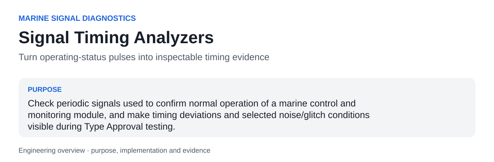
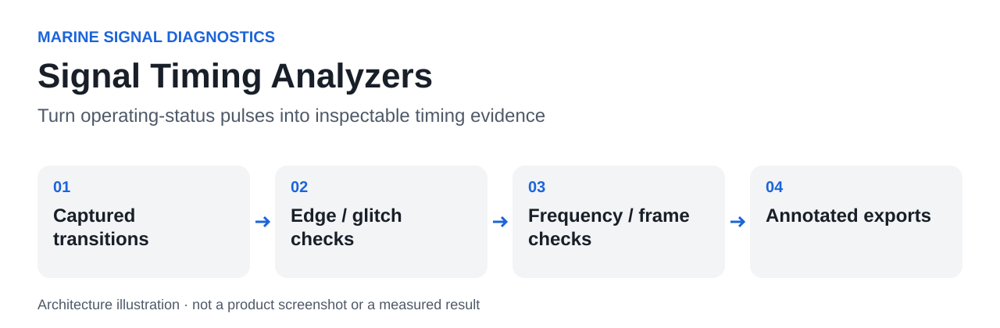

<a id="readme-top"></a>



# Signal Timing Analyzers

**Turn operating-status pulses into inspectable timing evidence.**

Check periodic signals used to confirm normal operation of a marine control and monitoring module, and make timing deviations and selected noise/glitch conditions visible during Type Approval testing.

| At a glance | |
|---|---|
| Context | Marine Signal Diagnostics |
| Current evidence | Author-confirmed test use; C++ plugins and real captures not rebuilt here |
| Stack | C++, Python, CMake, Saleae Analyzer SDK, Logic 2 HLA interface |
| Author | [hupositoc](https://github.com/hupositoc) |

[Case study](docs/case-study.md) · [Architecture](docs/architecture.md) · [Validation](docs/validation.md) · [Design rationale](docs/design-rationale.md)

## Table of Contents

- [About The Project](#about-the-project)
- [Getting Started](#getting-started)
- [Usage](#usage)
- [Roadmap](#roadmap)
- [Contributing](#contributing)
- [License](#license)
- [Contact](#contact)
- [Acknowledgments](#acknowledgments)

## About The Project

### Why I built it

The operating context is marine module testing associated with DNV-CG-0339 and LR-TS-01. The specific product, employer, test laboratory, acceptance limits and private recordings are not disclosed.

Raw digital transitions do not directly answer whether a periodic health signal remained normal. Short glitches and noisy edges can also create misleading decoded bits or frequency estimates. An operator needs a repeatable way to inspect the timing, identify exceptions, and distinguish raw events from tolerated or repaired interpretations.

### What I implemented

Use C++ low-level analyzers where direct access to sampled transitions is needed, and a Python high-level analyzer for grouped SPI-derived bit frames. Keep frequency expectations, edge selection and glitch-width settings visible. Include timing and correction metadata in analyzer output so a repaired interpretation is not mistaken for the original waveform.

### What this made possible

- Inspect expected-clock frequency and timing deviations at the captured-signal level.
- Decode SSI-related CLK/DATA behavior with selectable sampling edges and a configurable short-pulse threshold.
- Review grouped patterns and reported correction reasons instead of manually counting every transition.

### What happened in practice

The author confirms use for periodic normal-operation checks and the addition of filtering for some glitch/noise data. This supports analysis of performance logs; the repository does not claim that filtering establishes electrical immunity or proves compliance with every acceptance criterion.

### Built With

C++, Python, CMake, Saleae Analyzer SDK, Logic 2 HLA interface. Dependencies provide integration capabilities; the source links below identify the project-specific behavior.

### Engineering decisions

### Two levels of analysis

LLA code can examine sampled edges directly, while the HLA can reason about already decoded frames. These are complementary integration points, not duplicate implementations.

### Expose tolerances

The expected frequency and glitch threshold are test parameters. Their defaults are examples from this codebase, not requirements taken from a class rule.

### Preserve diagnostic meaning

Tolerance and correction logic should explain what was accepted and why. A clean-looking interpreted frame is not a replacement for the raw capture.

### Code to inspect

| Source entry point | Responsibility |
|---|---|
| [`SimpleSerialAnalyzer::WorkerThread`](clock-lla/src/SimpleSerialAnalyzer.cpp#L35) | Converts sampled edge intervals into clock-analysis output. |
| [`mExpectedFrequencyHz`](clock-lla/src/SimpleSerialAnalyzerSettings.cpp#L6) | Exposes expected frequency; the current code default is 300 Hz. |
| [`SimpleSerialAnalyzer::WorkerThread`](ssi-lla/src/SimpleSerialAnalyzer.cpp#L49) | Processes CLK/DATA edges and short clock pulses. |
| [`mGlitchPulseWidthLimitNs`](ssi-lla/src/SimpleSerialAnalyzerSettings.cpp#L8) | Configurable pulse-width threshold; current default 500 ns. |
| [`try_remove_glitch_bits`](hla/HighLevelAnalyzer.py#L218) | Attempts explicitly reported extra-bit recovery. |
| [`try_correct_bit_value_jitter_by_hamming`](hla/HighLevelAnalyzer.py#L829) | Checks tolerated bit differences against configured patterns. |

### AI-assisted engineering

I use AI development tools to turn concrete needs into working software. My engineering responsibilities include defining the problem, interpreting the operating constraints, reviewing behavior, investigating failures and checking results. AI assistance is a development method; it is not evidence that a feature works. File-by-file AI authorship or a specific assistant/model is not claimed without the corresponding development record.

## Getting Started

### Prerequisites

CMake, a compatible C++ compiler, Saleae Analyzer SDK access, and Logic 2. Load hla/ as a developer extension for the Python path.

### Installation

```text
git clone https://github.com/hupositoc/signal-timing-analyzers.git
cd signal-timing-analyzers
```

Then follow the project-specific path:

```text
cmake -S clock-lla -B build/clock
cmake --build build/clock --config Release
cmake -S ssi-lla -B build/ssi
cmake --build build/ssi --config Release
```

The commands describe the intended setup. See the validation record for which parts were actually executed in the current environment.

## Usage



**Text equivalent:** Captured transitions → Edge / glitch checks → Frequency / frame checks → Annotated exports.

Start by defining the intended input and expected behavior. Save the configuration with the experiment or test session so that an output can be interpreted later. Review exceptions and raw evidence before treating a summary as a final conclusion.

Python HLA syntax was parsed. Source paths, current defaults and exported result fields were inspected. No hardware-equivalence or filtering-performance claim is made.

### Boundaries and known limitations

- Signal patterns and default thresholds are application-specific examples.
- C++ plugins share a CMake target name and must be configured in separate build directories.
- SDK build, electrical sampling accuracy, false-positive/false-negative rates and captured-waveform replay remain unverified here.

Read the [case study](docs/case-study.md) for the purpose and enabled workflow, and [architecture](docs/architecture.md) for the source-level explanation. The [validation document](docs/validation.md) separates verified checks, author-reported use and pending integration work.

## Roadmap

- [ ] Create public fixtures for nominal, missing-edge, extra-edge and invalid-pattern cases.
- [ ] Measure detection behavior against manually labeled synthetic waveforms.
- [ ] Document threshold selection separately from the applicable test acceptance criteria.

These are planned tasks, not completed capabilities.

## Contributing

Use an issue to describe a reproducible problem, expected behavior, actual behavior and the environment. For a change, keep the scope focused and attach the relevant test or recording. Do not submit private customer data, identifying test captures, credentials or confidential certification documents.

## License

Existing file-level notices and third-party licenses remain in force. A repository-wide open-source license has not been selected for all archived material. Public visibility does not grant rights beyond those existing terms. Documentation structure attribution does not relicense the software.

## Contact

[hupositoc on GitHub](https://github.com/hupositoc) · [Project issues](https://github.com/hupositoc/signal-timing-analyzers/issues)

## Acknowledgments

The top-level section order follows [Best-README-Template](https://github.com/othneildrew/Best-README-Template), reviewed under its [Unlicense](https://github.com/othneildrew/Best-README-Template/blob/main/LICENSE.txt). All project narratives are written for this implementation. Visual guidance is attributed in [design rationale](docs/design-rationale.md). The broader 50-repository documentation review informs the reading order, source links and evidence presentation; it does not imply endorsement by those projects.


[Engineering decision record](docs/engineering-decisions.md) · [Review of 50 reference repositories](docs/reference-review-50.md)
